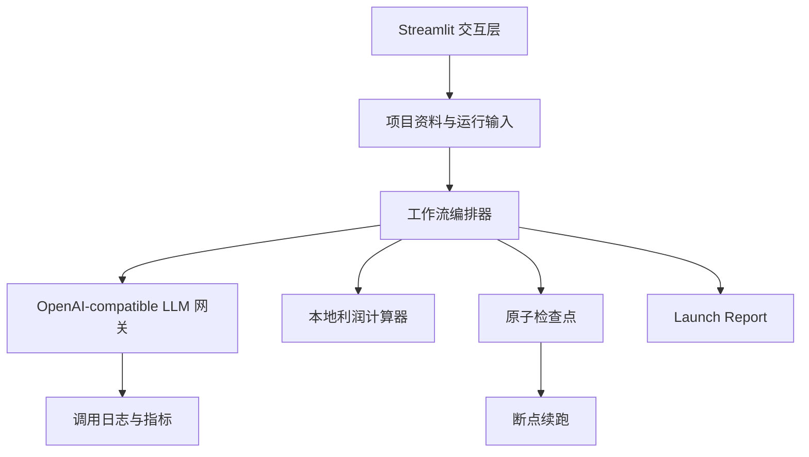
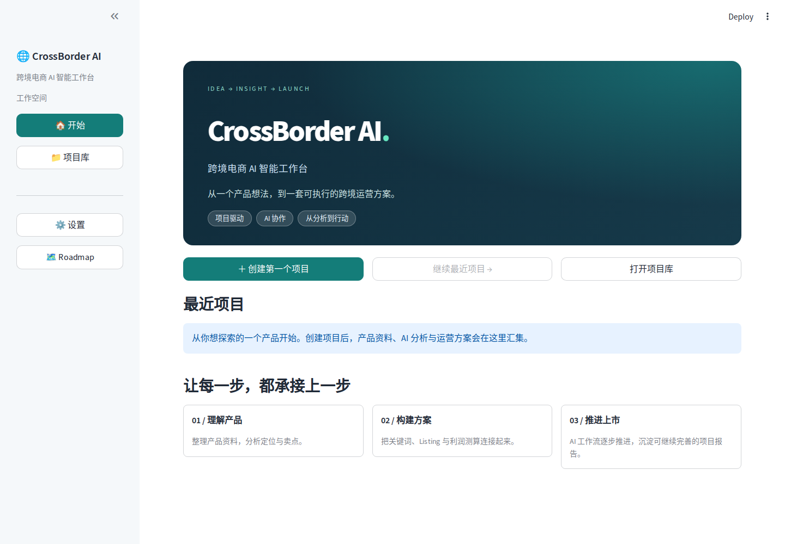
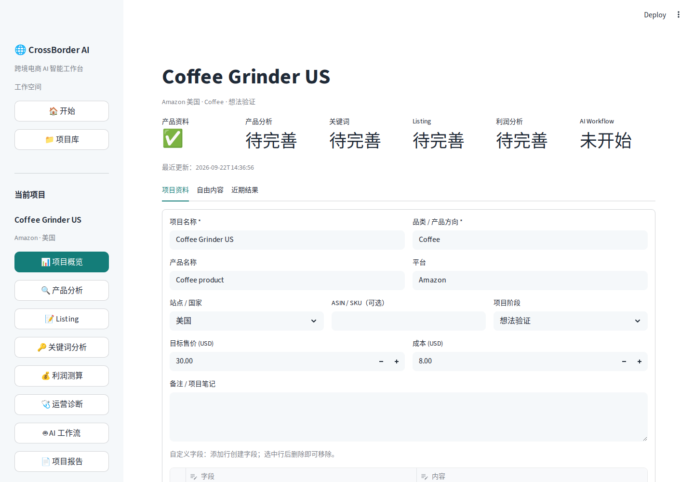
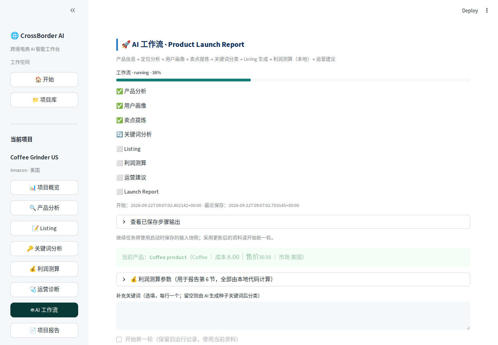

# CrossBorder AI Workbench · Showcase Edition

一个面向跨境电商选品与运营场景的 AI 项目工作台。项目重点不是“调用一次大模型”，而是把产品分析、用户画像、卖点、关键词、Listing、利润与运营建议组织成一条**可恢复、可追踪、可测试**的业务工作流。

> 本仓库是面向招聘评估的公开展示版：使用 Mock 数据和确定性工作流，不包含真实 API Key、用户数据、商业 Prompt 或完整产品实现。完整工程版本保存在私有仓库。

## 项目亮点

- **项目化工作台**：围绕独立项目保存资料、草稿、状态和报告，避免不同产品上下文串线。
- **八步 AI 工作流**：定位 → 用户画像 → 卖点 → 关键词 → Listing → 利润 → 运营建议 → Launch Report。
- **可靠性设计**：运行前冻结输入快照；每步形成检查点；失败后从未完成步骤继续；项目锁避免重复运行。
- **模型服务解耦**：完整版本通过统一网关接入 OpenAI-compatible 服务，集中处理配置、错误与调用指标。
- **关键计算可信**：利润、利润率和盈亏平衡 ACOS 使用本地 Python 公式，不让 LLM 猜数字。
- **工程验证**：完整版本包含项目生命周期、进程恢复、并发锁和 Mock LLM 编排等 19 项自动化测试。

## 系统结构



更详细的边界与设计原则见 [架构说明](docs/architecture.md)。

## 界面预览

### 项目入口



### 项目概览



### AI 工作流



## 本地运行公开 Demo

推荐 Python 3.11 或 3.12：

```bash
python -m venv .venv
# Windows
.venv\Scripts\activate
# macOS / Linux
source .venv/bin/activate

pip install -r requirements.txt
streamlit run app.py
```

公开 Demo 不调用外部模型，不需要 API Key。它用于演示工作流状态、审计事件与确定性利润计算。

## 运行测试

```bash
python -m unittest discover -s tests -v
```

## 仓库结构

```text
.
├─ app.py                 # 可直接运行的 Streamlit 展示应用
├─ workflow_demo.py       # 可追踪的 Mock 工作流状态机
├─ profit_calculator.py   # 真实的确定性利润计算模块
├─ tests/                 # 公开版回归测试
└─ docs/                  # 架构说明与精选界面截图
```

## 我在项目中解决的问题

1. 将多个孤立的 AI 功能重构为项目驱动的统一工作台。
2. 处理页面刷新、服务重启和步骤失败造成的长流程中断。
3. 用项目作用域、输入快照和原子写入保障数据一致性。
4. 把高风险数字计算移出 LLM，建立可复核的业务规则边界。
5. 通过 Mock LLM 和临时目录测试关键流程，减少真实模型调用成本。

## 技术栈

Python · Streamlit · OpenAI-compatible API · FileLock · JSON/Markdown Persistence · unittest

## 说明

本项目为个人学习与工程实践作品。公开代码仅用于作品评估与技术交流，未授予商业使用许可。

