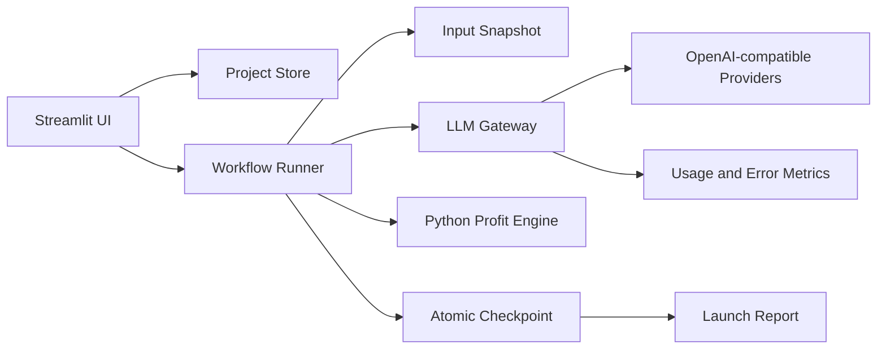

# Architecture Notes

## Design goals

- Treat project files and workflow checkpoints as the source of truth; UI session state is only a view cache.
- Snapshot inputs when a run starts so later edits cannot silently change an in-progress report.
- Persist each completed step before moving forward, enabling recovery without repeating successful model calls.
- Keep deterministic calculations outside the LLM boundary.
- Centralize provider configuration, retries, usage metrics, and error handling in one model gateway.

## Full-edition flow

## Public/private boundary

This public repository contains a deterministic workflow simulator, the real
profit-calculation module, tests, screenshots, and architecture documentation.
The private edition keeps the complete prompts, provider presets, persistence
layer, project lifecycle implementation, and production workflow orchestration.

